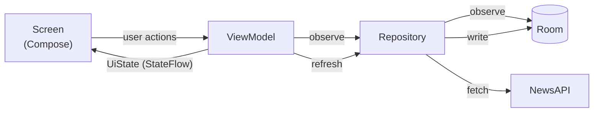

# NewsApp

An Android app that shows top headlines from [NewsAPI](https://newsapi.org), built with Jetpack Compose and an offline-first architecture.

## Features

- Top headlines for a selectable country, remembered across app restarts
- Filtering by one or more categories
- Article detail screen, with the full article opening in a Custom Tab
- Works offline: stored headlines show immediately on launch, also without a connection
- Pull to refresh, with a retry action when a refresh fails
- Light and dark theme, edge-to-edge, splash screen

## Getting started

### Requirements

- Android Studio with support for AGP 9.5
- JDK 17 or newer
- A NewsAPI key, free from [newsapi.org/register](https://newsapi.org/register)

### API key

The build reads `NEWS_API_KEY` from an environment variable or, if that isn't set, from `local.properties` in the project root:

```properties
NEWS_API_KEY=your-api-key
```

`local.properties` is ignored by Git. Without a key the app still builds, but every request fails and the app shows "The news service didn't accept the API key."

### Build and run

Open the project in Android Studio and run the `app` configuration, or from the command line:

```bash
./gradlew :app:installDebug
```

## Architecture

The app follows the [guide to app architecture](https://developer.android.com/topic/architecture): a UI layer and a data layer, with unidirectional data flow.



- **Room is the single source of truth.** Screens observe the database. A refresh fetches from the network and writes the result to the database, so the UI never reads network responses directly.
- **Freshness policy:** a refresh only calls the network for country and category combinations fetched 30 minutes ago or longer. Pull to refresh always fetches.
- **UI state:** each screen exposes one `StateFlow` of immutable UI state. Errors that happen during a refresh are part of that state and are cleared once the snackbar has shown them, so they survive configuration changes.
- **Route and Screen:** each `*Route` composable connects the ViewModel, and each `*Screen` composable is stateless, which keeps previews and UI tests independent of the ViewModel.
- **Navigation:** [Navigation 3](https://developer.android.com/guide/navigation/navigation-3) with a back stack of serializable keys. The detail ViewModel receives the article URL through Hilt assisted injection.

### Modules

The project is split into modules in the style of [Now in Android](https://github.com/android/nowinandroid):

| Module | Contents |
|---|---|
| `:app` | `MainActivity`, the application class, and navigation |
| `:feature:articlelist` | Headlines list, category filter and country picker |
| `:feature:articledetail` | Article detail screen |
| `:core:data` | Repositories, error types, and the DataStore for the selected country |
| `:core:database` | Room database, entities and DAO |
| `:core:network` | Retrofit API, network models and OkHttp setup |
| `:core:model` | Domain models shared by all layers |
| `:core:designsystem` | Theme, typography, spacing and reusable components |
| `:core:ui` | Shared UI components and utilities: article images, loading and message states, relative times and Custom Tabs |
| `:core:common` | Coroutine dispatchers and the clock |
| `:core:testing` | Fakes and test utilities |

Shared Gradle configuration lives in convention plugins in `build-logic`.

### Tech stack

Kotlin, Jetpack Compose with Material 3, Navigation 3, Hilt, Kotlin Coroutines and Flow, Room, DataStore, Retrofit with OkHttp and kotlinx.serialization, and Coil.

## Testing and code quality

```bash
./gradlew testDebugUnitTest            # unit and Robolectric UI tests
./gradlew :app:connectedDebugAndroidTest  # instrumented navigation test, needs a device
./gradlew ktlintCheck detekt           # formatting and static analysis
./gradlew koverHtmlReportDebug         # merged coverage report in app/build/reports/kover
```

- ViewModels and repositories are tested with fakes from `:core:testing`. Repository and DAO tests run against an in-memory Room database.
- Compose screens are tested with Robolectric, so they run as fast JVM tests.
- CI runs ktlint, detekt and the unit tests on every pull request, and requires 80% line coverage overall and on changed lines.

## Design decisions and trade-offs

### The API key ships in the app

The key is compiled into `BuildConfig`, so anyone with the APK can extract it. Code shrinking doesn't prevent that. For a real product the key would stay on a backend that proxies NewsAPI, with [Play Integrity](https://developer.android.com/google/play/integrity) or [Firebase App Check](https://firebase.google.com/docs/app-check) limiting who can call it. That is out of scope here.

NewsAPI's free plan is also only for development, not for apps in production.

### Request quota

The free plan allows 100 requests per day. NewsAPI accepts only one category per request, so filtering by several categories sends one request per category. To stay within the quota:

- Stored headlines are reused for 30 minutes before the app fetches them again.
- Only categories with stale or missing headlines are fetched; categories that are still fresh are served from the database.
- Each request asks for up to 50 articles, so one request per category is normally enough.

### Persistence

- The selected **country** is stored in DataStore, because people usually read news for one country.
- The selected **categories** are kept in `SavedStateHandle`. They survive configuration changes and process death, but not an app restart, since they're meant to be changed on the fly.

### Known limitations

- English only.
- A list shows at most 50 headlines per category; there is no paging yet.
- NewsAPI truncates article content, so the detail screen shows a preview with a link to the full article.
